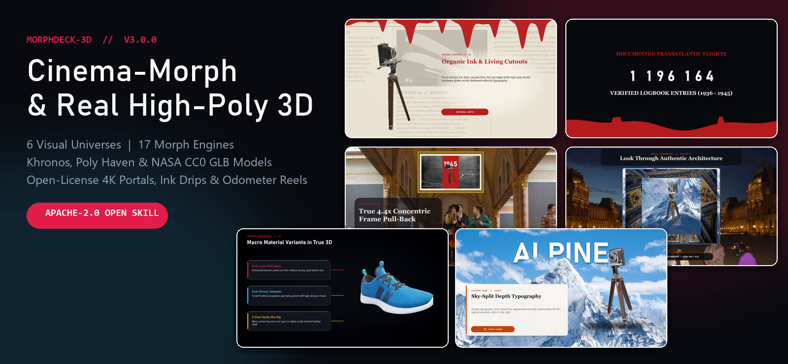
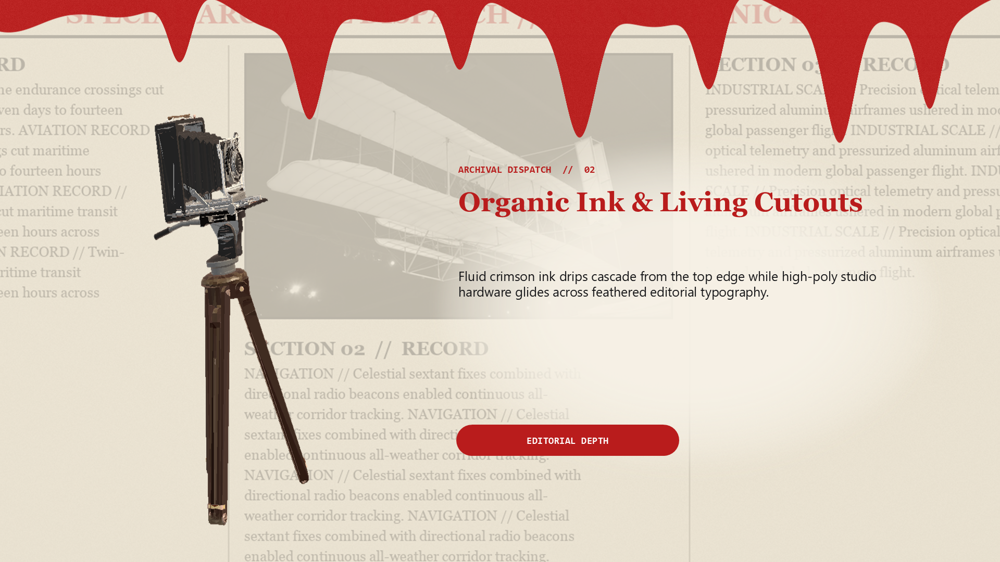
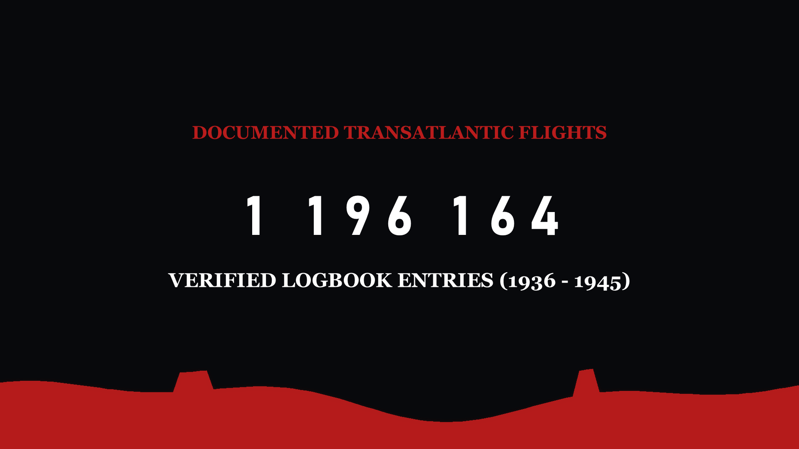
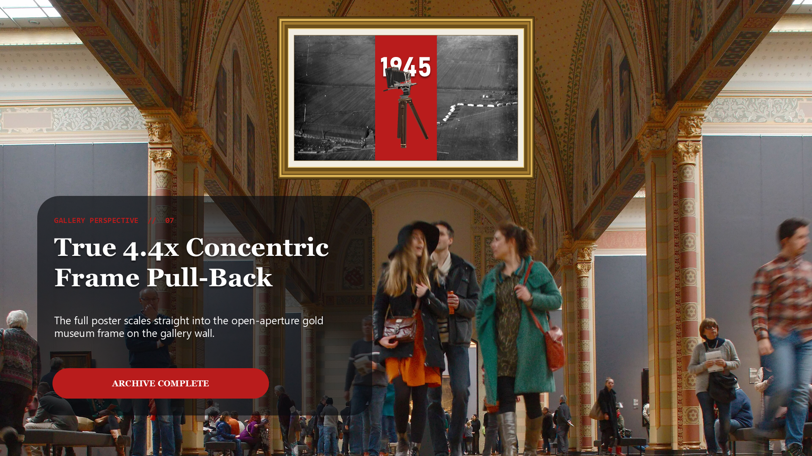
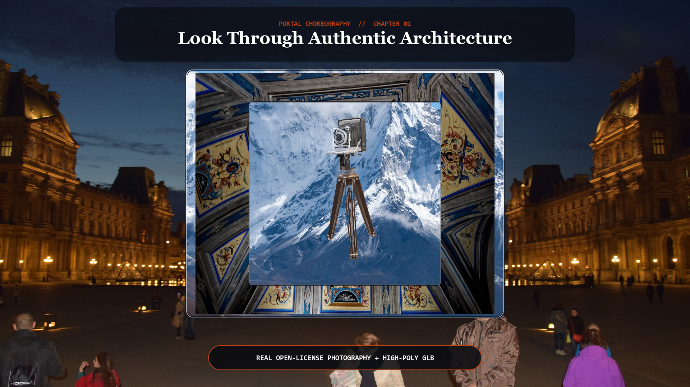
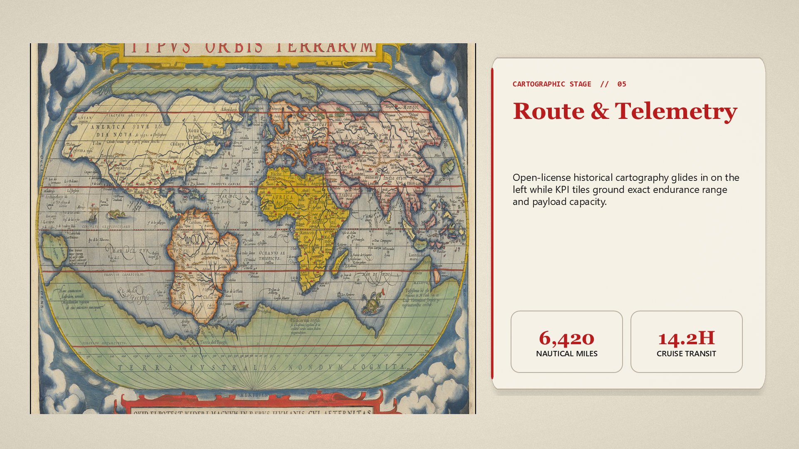
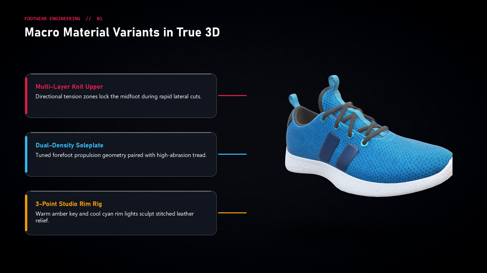

<div align="center">

# MorphDeck 3D (`morphdeck-3d`)

**Cinema-Morph & Photorealistic 3D PowerPoint Engineering Skill for AI Coding Agents**

[](LICENSE)
[](CHANGELOG.md)
[](pyproject.toml)
[](#6-visual-universes)
[](#17-cinema-morph-slide-engines)
[](#real-high-poly-cc0-3d--open-license-4k-photography)
[](#quickstart-installation)



</div>

---

## Why MorphDeck 3D v3.0.0?

Most AI presentation tools produce identical SaaS templates, repetitive bullet boxes, or synthetic primitive 3D toys. **MorphDeck 3D v3.0.0** is an open-source Agent Skill and dual-engine OpenXML/COM pipeline engineered to craft **documentary, architectural, museum, sneaker-drop, and executive decks** using **native PowerPoint Morph choreography, real high-poly CC0 `.glb` 3D geometry, and genuine open-license photography**.

| Capability | Generic AI Slide Generators | MorphDeck 3D v3.0.0 (`morphdeck-3d`) |
| :--- | :--- | :--- |
| **3D Visual Fidelity** | Flat stock icons or awkward boxy toys | **Real Khronos, Poly Haven photogrammetry & NASA CC0 `.glb` models** illuminated by calibrated **3-point colored `<am3d:ptLight>` studio rigs** |
| **Cinema-Morph Motion** | Hard slide cuts or broken raw XML tags | **Broadsheet Newspaper Dives (`3.6x`)**, **Black-Curtain Rolling Odometer Reels**, **Diagonal Cloud Sweeps**, **4.4x Concentric Hollow-Frame Pull-Backs**, **Real Portal Fly-Throughs**, and **2-Stop Sky-Split Elevators** |
| **Editorial Craft** | Rigid opaque rectangles everywhere | **Organic Liquid Ink Drips**, **Feathered Paper Clouds**, **Silhouette Horizons**, and **Gaussian Backdrop-Refracted Glass Docks** |
| **Domain Adaptation** | Same slide structure reused across projects | **6 Visual Universes** + **17 Morph Slide Engines** auto-routed per topic & narrative arc |
| **OS Support & QA** | Windows-only scripts or unchecked builds | **Windows PowerPoint COM** (live `.glb` + `1920x1080` lit export) AND **Cross-Platform Python OpenXML + NumPy PBR Renderer**, gated by `validate_spec.py` + `verify_deck.py` |

---

## Showcase Renders (Exported Directly from PowerPoint COM)

| Editorial Print Drips (`documentary_press` + `AntiqueCamera`) | Black-Curtain Odometer (`1 196 164` Reels + Crimson Horizon) |
| :---: | :---: |
|  |  |
| **4.4x Concentric Frame Pull-Back (`Louvre` + Hollow Gold Frame)** | **Authentic Portal Fly-Through (`architectural_portal` + `AntiqueCamera`)** |
|  |  |
| **Sky-Split Vertical Elevator (`Matterhorn` + Occluded Display Type)** | **Backdrop-Refracted Glass Dock (`Uffizi` + 3-Point Lighting)** |
|  |  |
| **Cartographic Cutout Stage (`Typus Orbis Terrarum` + KPIs)** | **Rotational Macro 3D (`commercial_studio` + `MaterialsVariantsShoe`)** |
|  |  |

---

## 6 Visual Universes

| Universe | Lighting & Canvas | Display Typography | Best Fit |
| :--- | :--- | :--- | :--- |
| `documentary_press` | Archival broadsheet `#EAE3D2`, crimson `#B91C1C` | Georgia + Bahnschrift | History, investigative journalism, museums, aviation & archive documentaries |
| `architectural_portal` | Warm travertine `#F4EFE6`, sienna `#C2410C`, teal `#0D9488` | Georgia + Bahnschrift | Luxury real estate, architectural pavilions, optical & hospitality showcases |
| `sculptural_museum` | Midnight obsidian `#0A0C12`, terracotta `#E07A5F`, gold `#D4AF37` | Georgia + Bahnschrift | Curated exhibitions, sculptural art, luxury heritage brands |
| `commercial_studio` | Studio black `#080A0F`, crimson `#E11D48`, cyan `#38BDF8` | Bahnschrift + Impact | Footwear drops, automotive launches, flagship hardware releases |
| `executive_swiss` | Swiss paper `#F8FAFC`, royal blue `#2563EB`, hairline `#CBD5E1` | Bahnschrift + Consolas | Board decks, FinOps reviews, SaaS metrics, consulting readouts |
| `editorial_pop` | Deep violet `#0F0C18`, magenta `#EC4899`, cyan `#06B6D4` | Impact + Bahnschrift | Creator launches, audio gear, gaming, energetic product storytelling |

---

## 17 Cinema-Morph Slide Engines

| Category | Engines |
| :--- | :--- |
| **Documentary & Editorial** | `newspaper_dive`, `editorial_print_overlay`, `odometer_counter`, `flyby_wipe`, `cutout_map_stage`, `poster_depth_reveal`, `picture_frame_pullback` |
| **Spatial & Photographic** | `real_portal_flythrough`, `refracted_spotlight_dock`, `parchment_3d_split`, `vertical_world_elevator` |
| **Technical, Bento & Close** | `rotational_drift_3d`, `swiss_bento_morph`, `timeline_rail_morph`, `chart_infographic`, `architecture_blueprint`, `closing_finale` |

Explore every schema and Morph naming rule in [references/universes-and-transitions-bible.md](references/universes-and-transitions-bible.md) and ready-to-build specs in [examples/](examples/).

---

## Real High-Poly CC0 3D & Open-License 4K Photography

- **`scripts/fetch_real_glb.py`**: Fetches real studio-grade `.glb` models from **Khronos glTF-Sample-Assets** (`AntiqueCamera`, `MaterialsVariantsShoe`, `DamagedHelmet`, `GlamVelvetSofa`, `SheenChair`, `BoomBox`, `Lantern`, `CarConcept`, `WaterBottle`), **Poly Haven CC0 photogrammetry scans** (packed straight from `.gltf` + textures to binary `.glb`), and **NASA 3D Resources** spacecraft.
- **`scripts/fetch_real_photo.py`**: Searches and caches real >= 1200 px open-license architecture, alpine, cartographic, and gallery photography via the **Wikimedia Commons API** — never calibration spheres or synthetic checkerboards.
- **`scripts/studio_cutout.py`**: Generates perimeter-flood-filled RGBA studio cutouts (`make_studio_cutout`), architectural portal punches (`punch_portal_mask`), terrain sky splits (`split_horizon_cutout`), Gaussian backdrop refraction (`render_refracted_glass_dock`), organic ink drips (`render_organic_ink_drips`), feathered paper clouds (`render_soft_paper_cloud`), volumetric cloud sweeps (`render_cloud_sweep`), horizon silhouettes (`render_silhouette_horizon`), and hollow transparent-aperture museum gold frames (`render_hollow_gold_frame`).

---

## Quickstart Installation

### Option 1: Install as an AI Agent Skill (Antigravity, Claude Code, Codex, Cursor)

```bash
git clone https://github.com/7AK3SH1/morphdeck-3d.git
cd morphdeck-3d
pip install -r requirements.txt
```

```powershell
# Windows (PowerShell) - choose: antigravity | claude | codex | cursor | all
.\install.ps1 -Target antigravity
```

```bash
# macOS / Linux (Bash) - choose: antigravity | claude | codex | cursor | all
./install.sh claude
```

### Option 2: Use the Turnkey CLI Directly

```bash
# 1. List all 6 visual universes and 17 Cinema-Morph engines
python scripts/morphdeck.py universes

# 2. Scaffold a v3 starter spec (documentary_press | architectural_portal | commercial_studio)
python scripts/morphdeck.py init --template documentary_press --out work/deck_spec.json

# 3. Fetch any real high-poly CC0 .glb by topic or inspect its studio preview PNG
python scripts/morphdeck.py fetch-3d --auto "sneaker" --out work/hero.glb
python scripts/morphdeck.py preview-3d --glb work/hero.glb --theme commercial_studio --out work/preview.png

# 4. Build PPTX + inject 3-point <am3d:ptLight> + export 1080p PNGs + verify XML
python scripts/morphdeck.py build --spec work/deck_spec.json --out Output_Cinema.pptx --export-dir work/renders
```

---

## Pipeline Architecture

```text
  deck_spec.json  (v3 universe + hero_3d + 17 Cinema-Morph engines  |  or v2 legacy schema)
        |
        v
  [1] validate_spec.py          Pre-flight v2/v3 schema, #RRGGBB colors & zero-emoji gate
        |
        v
  [2] prepare_cinema_assets.py  Resolves:
        |-- fetch_real_glb.py   -> High-poly Khronos / Poly Haven / NASA .glb + GLB RGBA cutouts
        |-- fetch_real_photo.py -> Open-license 4K Wikimedia Commons landscapes, villas & maps
        |-- studio_cutout.py    -> Ink drips, paper clouds, hollow gold frames, portal masks, sky splits
        |-- 2x supersampled comparison charts & stacked architecture diagrams
        |
        v
  [3] Dual Build Engine + 3-Point <am3d:ptLight> Studio Optics
        |-- Windows PowerPoint COM (build_cinema_deck.ps1 -> inject_3d_studio_lighting.py -> -ExportOnly)
        |-- macOS / Linux / CI (build_cinema_crossplatform.py + render_glb_preview.py)
        |
        v
  [4] verify_deck.py            Enforces 0 XML errors, 0 external links, <mc:AlternateContent><p159:morph/>,
                                embedded .glb + <am3d:ptLight> counts, 0 emojis, and 1080p render stddev
```

---

## License & Attribution

**Copyright 2026 (`7AK3SH1`)**

Licensed under the **Apache License, Version 2.0** (see [LICENSE](LICENSE) and [NOTICE](NOTICE)).

Under Apache-2.0 Section 4(d), any redistribution, fork, mirror, Agent Skill registry listing, or derivative software incorporating any part of `morphdeck-3d` **must preserve the [NOTICE](NOTICE) attribution file** crediting **Mohamed S. Sissoko (`7AK3SH1`)** and the canonical repository `https://github.com/7AK3SH1/morphdeck-3d`.
