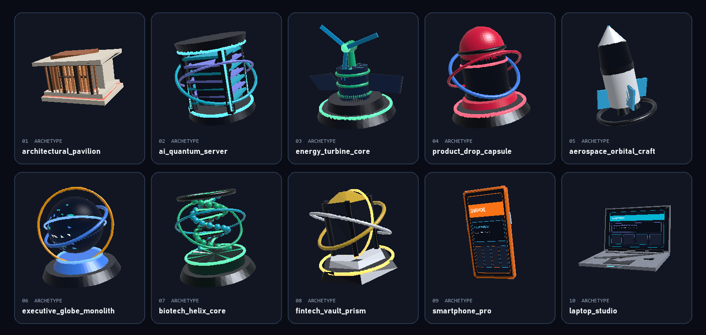
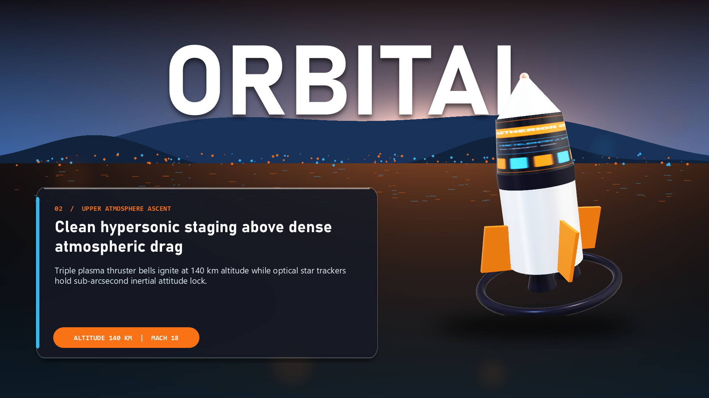
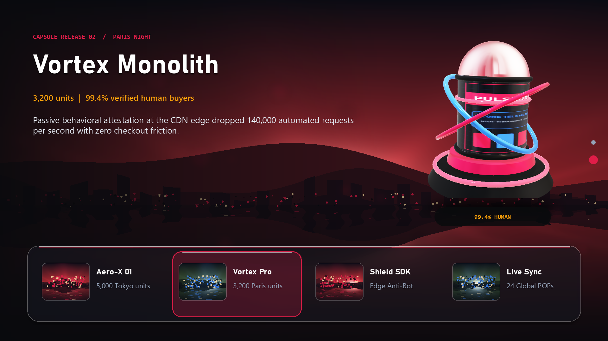
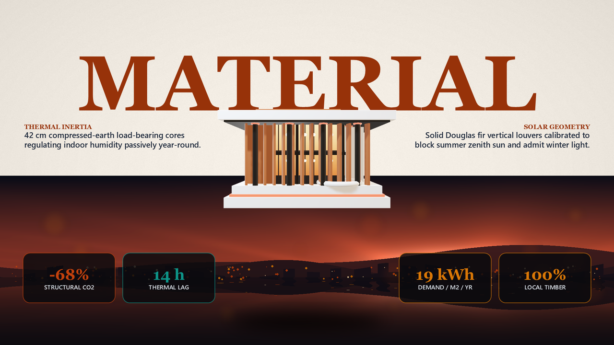
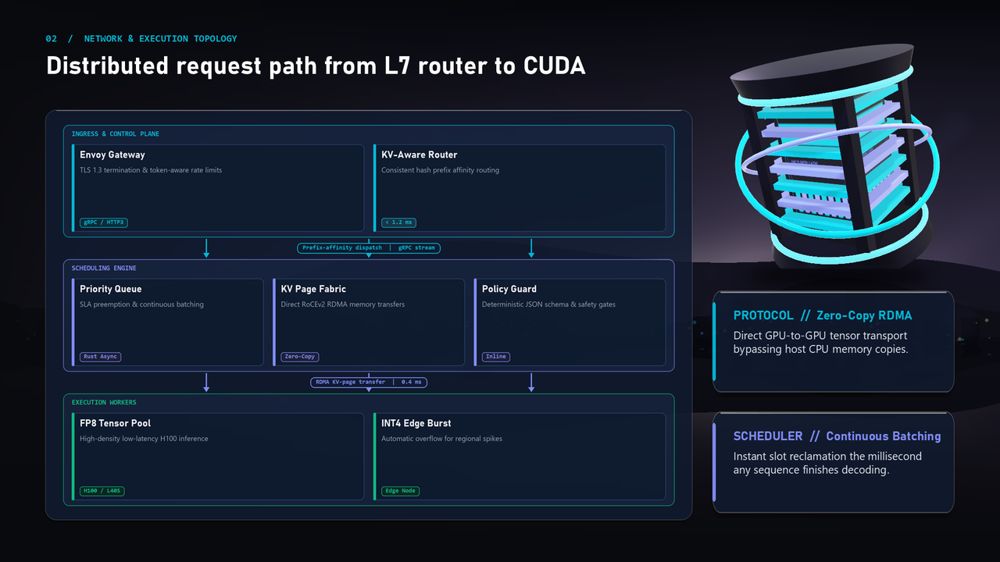
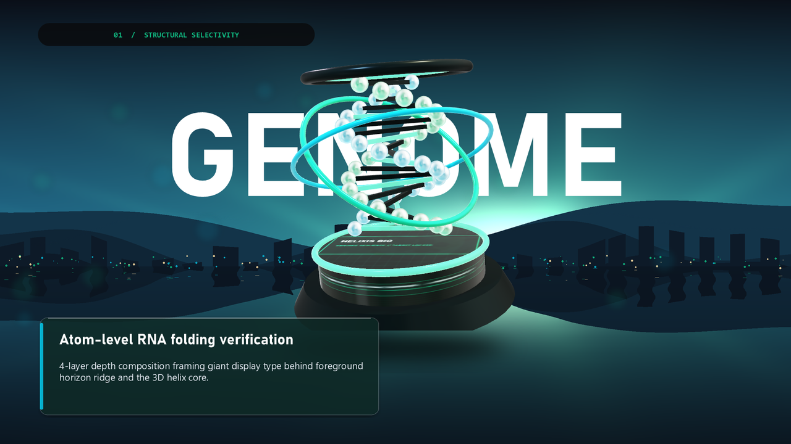

<div align="center">

# MorphDeck 3D (`morphdeck-3d`)

**Cinematic 3D glTF + Morph PowerPoint Engineering Skill for AI Coding Agents**

[](LICENSE)
[](CHANGELOG.md)
[](pyproject.toml)
[](#10-procedural-pbr-3d-glb-archetypes-zero-third-party-binaries)
[](#7-themes--19-slide-methods)
[](#pipeline-architecture)
[](#quickstart-installation)


</div>

---

## Why MorphDeck 3D?

Most AI-generated slide tools output flat 2D boxes with static bullet lists and recycled color palettes. **MorphDeck 3D** is an open-source Agent Skill and dual-engine presentation pipeline designed to engineer **cinema-grade 3D `.glb` + PowerPoint Morph decks from scratch** -- tailored automatically to the subject, industry, visual aesthetic, and narrative cadence of each project.

| Feature | Generic AI Slide Generators | MorphDeck 3D v2.0.0 (`morphdeck-3d`) |
| :--- | :--- | :--- |
| **3D Visual Centerpiece** | Flat stock icons or static screenshots | **10 original procedural PBR glTF 2.0 (`.glb`) 3D models** lit by a theme-calibrated **3-point colored `<am3d:ptLight>` studio rig** |
| **Transitions & Camera Motion** | Hard cuts or broken raw `<p159:morph>` tags | **Optical Portal Fly-Throughs (`4.6x` aperture zoom)**, **2-Stop Vertical World Elevators (`-520 pt` pan)**, **`srcRect` Curtain-Wipe Reveals**, and **Staggered Off-Canvas Velocity Cascades** |
| **Slide Depth & Glass** | Flat backgrounds + opaque boxes | **4-Layer Depth Sandwich** + **True Backdrop-Refracted Frosted Glass (`GaussianBlur(24)` + specular rim)** |
| **Structural Originality** | Same repetitive slide outline every time | **19 composable slide methods** & **7 distinct theme systems** diagnosed per project in Step 0 |
| **OS Support** | Proprietary web lock-in or Windows-only hacks | **Dual Engine**: Windows PowerPoint COM (live `.glb` embedding + studio lighting + `1920x1080` export) AND pure-Python cross-platform OpenXML + NumPy PBR studio renderer |
| **Verification** | None | **Automated Quality Gate** (`validate_spec.py` + `verify_deck.py`): 0 XML errors, 0 external links, `<am3d:ptLight>` count verification, 0 emojis |

---

## 10 Procedural PBR 3D `.glb` Archetypes (Zero Third-Party Binaries)

Every 3D model is procedurally synthesized in pure Python + NumPy into binary **glTF 2.0 (`.glb`)** with analytical vertex normals, forward-facing UV coordinates, 5 PBR metallic-roughness materials, and custom-baked `1024x1024` self-lit core textures tinted to the project's palette and brand name.



| # | `hero_3d.archetype` | Target Domains | Procedural 3D Architecture |
| :-: | :--- | :--- | :--- |
| 01 | `architectural_pavilion` | Architecture, Real Estate, Construction | Travertine podium, bronze portico columns, 14 Douglas fir louvers, infinity basin, cantilevered roof + illuminated oculus |
| 02 | `ai_quantum_server` | AI Infra, Cloud, Cybersecurity, DevOps | Anodized titanium tower, 7 GPU tensor blades, glowing RDMA bus bars, self-lit silicon core, dual orbital gimbal rings |
| 03 | `energy_turbine_core` | CleanTech, Solar, Wind, Smart Grids | Industrial plinth, LFP storage tower, tilted crystalline solar arrays, 3-blade rotor & nacelle |
| 04 | `product_drop_capsule` | E-Commerce, Hardware Drops, Consumer Brands | Levitating pedestal, brand-wrapped monolith cylinder & metallic dome, intersecting kinetic speed rings |
| 05 | `aerospace_orbital_craft` | Aerospace, Autonomous Mobility, Defense | Multi-stage metallic fuselage, 4 swept delta fins, nosecone fairing, 3 plasma thruster bells |
| 06 | `executive_globe_monolith` | FinOps, Strategy, Consulting, Enterprise | Tiered architectural plinth, illuminated continental network sphere, brushed titanium & champagne gold meridian rings |
| 07 | `biotech_helix_core` | Biotech, Genomics, Pharma, MedTech | 20-step DNA double-helix phosphate backbone & glowing base-pair rungs inside biosensor containment rings |
| 08 | `fintech_vault_prism` | FinTech, Security, Cryptography, Ledger | Hexagonal encrypted crystal vault monolith, 6 armor corner ribs, 3 interlocking titanium security rings |
| 09 | `smartphone_pro` | Mobile Apps, Field Operations, SaaS | Rounded anodized titanium chassis, triple-lens camera island, Dynamic Island, custom-baked OLED UI screen |
| 10 | `laptop_studio` | Developer Consoles, Web Platforms, B2B | Space-gray aluminum unibody, 60-key cap grid, glass trackpad, barrel hinge, live dashboard display |

> Need your own custom Blender/CAD model? Pass `"archetype": "custom"` with `"custom_glb_path"` — `scripts/bake_glb_screen.py` can even bake live UI screenshots directly onto custom `.glb` display meshes.

---

## Showcase Renders (Exported Directly from PowerPoint COM)

| Optical Portal Fly-Through (`obsidian_kinetic` + `aerospace_orbital_craft`) | 2-Stop Vertical World Elevator (`vertical_elevator_3d` + Occluded Display) |
| :---: | :---: |
|  |  |
| **Backdrop-Refracted Glass Dock (`kinetic_poster` + `product_drop_capsule`)** | **Architecture Split-Horizon (`editorial_ivory` + `architectural_pavilion`)** |
|  |  |
| **Cloud & AI Topology (`cyber_blueprint` + `ai_quantum_server`)** | **Biotech 4-Layer Depth Sandwich (`biotech_luminance` + `biotech_helix_core`)** |
|  |  |

---

## Quickstart Installation

### Option 1: Install as an AI Agent Skill (Antigravity, Claude Code, Codex, Cursor)

```bash
git clone https://github.com/7AK3SH1/morphdeck-3d.git
cd morphdeck-3d
pip install -r requirements.txt
```

Then run the installer for your agent environment:

```powershell
# Windows (PowerShell) - choose: antigravity | claude | codex | cursor | all
.\install.ps1 -Target antigravity
```

```bash
# macOS / Linux (Bash) - choose: antigravity | claude | codex | cursor | all
./install.sh claude
```

### Option 2: Use the Turnkey CLI Directly

```bash
# 1. Discover all 10 3D archetypes, 7 themes, and 19 slide methods
python scripts/morphdeck.py list

# 2. Initialize a starter deck specification (aerospace | architecture | ai | product | executive | biotech | mobile)
python scripts/morphdeck.py init --template aerospace --output work/deck_spec.json

# 3. Preview any 3D archetype as a studio PNG in under 1 second
python scripts/morphdeck.py preview-3d --archetype biotech_helix_core --brand "HELIXIS" --output preview.png

# 4. Validate, synthesize 3D assets, build PowerPoint .pptx, and run all OpenXML checks
python scripts/morphdeck.py build work/deck_spec.json --out Helixis_Deck.pptx --renders work/renders
```

---

## Pipeline Architecture

```text
  deck_spec.json  (theme + hero_3d.archetype + 19 composable slide methods)
        |
        v
  [1] validate_spec.py          Pre-flight schema, #RRGGBB palette, archetype & character limits
        |
        v
  [2] render_studio_assets.py   Synthesizes:
        |-- generate_subject_glb.py -> Domain PBR glTF 2.0 (.glb) + 1024x1024 core texture
        |-- Optical portal aperture masks (portal_outer.png + portal_inner.png)
        |-- 1920x2160 2-stop vertical elevator panoramas & ridge cutouts
        |-- True backdrop-refracted glass docks (GaussianBlur(24) + specular rim)
        |-- 4-Layer Depth Sandwich terrain cutout + 2x supersampled charts & diagrams
        |
        v
  [3] Dual Build Engine + 3D Studio Optics
        |-- Windows PowerPoint COM (build_deck.ps1 -> inject_3d_studio_lighting.py -> -ExportOnly):
        |     Embeds .glb once -> clones persistent shapes via .Duplicate() -> injects 3-point colored
        |     <am3d:ptLight> studio rig -> re-opens cleanly & exports 1920x1080 lit PNGs
        |-- macOS / Linux / CI (build_deck_crossplatform.py + render_glb_preview.py):
        |     Renders 3-point theme-lit PBR studio views -> python-pptx OpenXML assembly
        |     -> injects ECMA-376 <mc:AlternateContent><p159:morph/> XML
        |
        v
  [4] verify_deck.py            Enforces 0 XML errors, 0 external links, Morph tags,
                                embedded .glb count, <am3d:ptLight> rig verification, 0 emojis, and 1080p renders
```

---

## 7 Themes & 19 Slide Methods

- **7 Built-in Theme Systems**: `obsidian_kinetic`, `editorial_ivory`, `cyber_blueprint`, `kinetic_poster`, `executive_clean`, `biotech_luminance`, `monochrome_luxury`.
- **19 Composable Slide Methods**: `cover_hero`, `portal_flythrough_3d`, `vertical_elevator_3d`, `split_horizon_3d`, `depth_sandwich_pan`, `macro_dolly_3d`, `orbit_steps_3d`, `timeline_morph_step`, `kpi_bento`, `chart_infographic`, `architecture_diagram`, `problem_solution_split`, `comparison_matrix`, `chapter_divider_morph`, `editorial_split`, `spotlight_dock`, `macbook_studio_3d`, `full_bleed_visual`, `closing_finale`.

Explore all schemas in [references/themes-and-methods-catalog.md](references/themes-and-methods-catalog.md) and ready-to-build domain specs in [examples/](examples/).

---

## Inspiration & Design Philosophy

**MorphDeck 3D** is inspired by modern editorial 3D presentation design — specifically the craft of optical aperture fly-throughs, vertical multi-stop world panoramas, Split-Horizon contrast pivots, Depth-Sandwich typographic occlusion, continuous camera-orbit Morph transitions, and tactile backdrop-refracted glass surfaces — re-engineered from first principles into a 100% original, deterministic open-source automation pipeline for AI agents.

---

## License & Attribution

**Copyright 2026 (`7AK3SH1`)**

Licensed under the **Apache License, Version 2.0** (see [LICENSE](LICENSE) and [NOTICE](NOTICE)).

Under Apache-2.0 Section 4(d), any redistribution, fork, mirror, Agent Skill registry listing, or derivative software incorporating any part of `morphdeck-3d` **must preserve the [NOTICE](NOTICE) attribution file** crediting **Mohamed S. Sissoko (`7AK3SH1`)** and the canonical repository `https://github.com/7AK3SH1/morphdeck-3d`.
